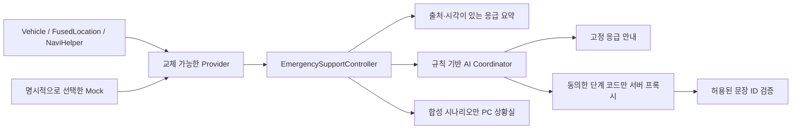

# 차량 정보 기반 응급 요약·AI 응급 대기 동행

2026-11-14 · LifeLink 119 v0.18.0-demo 고도화 구현 보고서

2026-11-15 추가 구현: [.env 실제 LLM 연결·자동 음성 동행](VOICE_AI_IMPLEMENTATION.md), [최신 검증 결과](VOICE_AI_VERIFICATION.json). 아래 8절의 수치는 11월 14일 기준선이며 음성 추가 검증은 새 문서를 따른다.

## 1. 기존 프로젝트 확인

[개발 전 점검표](EMERGENCY_UPGRADE_AUDIT.md)에 기능별 기준선과 추가 개발 범위를 기록했다. Kotlin/Android native View, Android 비의존 core, Python 로컬 상황실을 유지했다. 기존 홈, 119 긴급신고·응급상담, 112·109 모의 연결, 가족 안심콜, 건강정보 암호화, 응급 매뉴얼, 접근성, EV, 협력 시연을 새 앱으로 대체하지 않았다.

새 진입점은 **119 연결 화면 → 응급 요약 · 연결 대기 지원**이다. 119 신고 전후와 콜백·출동 대기 맥락을 이 화면군에서 이어간다. 기존 가상 상담원 응답과 새 ‘실제 연결 여부 미확인’ 상태는 분리했다. 전자는 시연 진행이고 후자는 앱이 확인할 수 있는 정보의 한계다.

## 2. 구현한 기능

| 영역 | 동작 |
|---|---|
| 차량·위치 자동 준비 | 요청별 명시적 동의 후 전경에서 주기적 조회. Vehicle/Location/Navigation Provider 분리, 실패 시 미확인/미지원 표시 |
| 출처·최신성 | 차량 SDK 확인/사용자 입력/시뮬레이션/미지원/확인 불가 구분. 측정·수신 시각, 벽시계와 부팅 후 경과 시간으로 최신성 검사 |
| 응급 패킷 | 짧은 읽어주기 요약과 차량·출처 상세, 환자 상태와 차량 신호 분리. 별도 동의 후 복사/가족 공유 앱 선택 |
| 신고 상태 | 준비, 시도, 미확인, 상담원, 콜봇, 지연, 콜백, 접수 안내, 출동 대기 안내, 구조대 도착. 확인 상태는 사용자 입력 또는 합성 시연만 허용 |
| 대기 지원 | ‘환자는 의식이 있나요?’ → 정상 호흡 → 상태 변화. 예/아니요/잘 모르겠어요, 건너뛰기, 중단, 재확인 |
| 위험 안내 | 의식·호흡 미확인, 출혈, 흉통, 뇌졸중 의심 징후, 부상, 화재/연기/갇힘, 혼자 대기, 동승자 환자 카드. 위험 답변은 고정 절차 우선 |
| 상태 기록·인계 | 사용자가 선택한 관찰 코드와 시각·출처만 기록. 초기/최근 상태와 악화를 요약하며 진단이나 AI 추론을 추가하지 않음 |
| 외부 LLM | .env 서버 프록시, Mock/External Provider, 승인 질문 ID와 확인이 필요한 관찰 코드만 수용. 기본 오프라인 작동 |
| 음성 | 한 번 시작 후 로컬 한국어 TTS와 기기 내 STT/Vosk를 순서대로 실행. 사용자의 한 번 시작 요청 뒤 질문과 듣기를 이어가며 연결 시도/연결 중에는 정지 |
| 복구 | 인증·명시적 선택 후 답변/시각만 1시간 AES-GCM 보관. 재시작 후 인증하여 복구, 통화 상태는 미확인·AI는 중단 상태 |
| PC 상황실 | 별도 합성 스냅샷 API/패널, 명시적 게시·철회. 실제 좌표·환자 원문·가족 정보는 API 입력으로도 받지 않음 |

## 3. 주요 파일과 책임

| 파일/폴더 | 책임 |
|---|---|
| `core/emergency/EmergencyContext.kt` | Evidence, 스냅샷, Provider 계약, 최근 위치 표본, 짧은/상세 요약 |
| `core/emergency/EmergencyCallSession.kt` | 실제 여부를 추정하지 않는 신고/콜백/출동 상태와 음성 중지 정책 |
| `core/emergency/EmergencyAiCoordinator.kt` | 질문 흐름, 관찰, 위험 규칙, 출처가 있는 고정 카드, LLM 응답 허용 목록 |
| `core/emergency/MockEmergencyProviders.kt` | 5개 독립 합성 시나리오. SDK 실패 시 몰래 대체하지 않음 |
| `vehicle/EmergencySdkProviders.kt` | 기존 Vehicle Gateway 재사용, FusedLocation 읽기·권한·타임아웃 |
| `vehicle/PleosEmergencyNavigationProvider.kt` | 내비의 현재 주소 후보만 읽기. 목적지 변경·경로 제어 없음 |
| `data/EmergencySupportController.kt` | 요청별 수집 동의, 전경 수집, 세션 연결, 메모리 잠금·정리 |
| `data/EmergencyCheckpointStore.kt` | 기존 MedicalCrypto 재사용, 인증, 보관 기한·부팅/시계 변화 검사 |
| `data/EmergencyNetwork.kt` | 앱→localhost 프록시, 합성 PC 게시·철회, 제한된 JSON 응답 |
| `data/EmergencyVoice.kt` | 로컬 음성만 선택, 통화/오디오 포커스/백그라운드 보호 |
| `ui/EmergencySupportUi.kt` | 요약/진행/동행/설정/시연 화면군. 기존 `ExpansionUi.kt`에는 진입·생명주기 연결만 추가 |
| `console/emergency.py`, `console/server.py` | 합성 코드 계약, LLM 프록시, 제한·만료·철회, HTTP 경계. Windows 포트 중복 바인딩 방지 |
| `console/static/experience.js` | 기존 PC 상황실에 응급 대기 시뮬레이션 패널 추가 |
| `EmergencySupportTest.kt`, `console/test_emergency.py` | 상태·최신성·개인정보·LLM 실패/주입·서버 계약 검사 |
| `scripts/verify-emergency-support.py`, `verify-emergency-recovery.py` | 전용 QA AVD에서 시연, SDK 실패 처리, 암호화·복구·잠금 검증 |

위 Kotlin 경로의 기준은 `app/src/main/java/com/lifelink119/app/`이며 테스트는 `app/src/test/java/.../core/`이다.



## 4. 실제 SDK와 Mock 구분

| 정보 | 구현/API·권한 | 현재 확인 수준 |
|---|---|---|
| 도어 | Vehicle 2.3.2 기존 조회, `CAR_DOORS` | 공식 Pleos AVD에서 SDK 응답 수신. 에뮬레이터 출처 표시 |
| EV SOC | Vehicle 2.3.2 기존 조회, `CAR_ENERGY` | 공식 AVD에서 SDK 응답 수신 |
| 에어백 | Vehicle Safety capability → 운전석 조회, `CAR_SAFETY` | API는 존재하나 현재 공식 AVD는 미지원. 전개 사고는 Mock만 가능 |
| 충돌 이벤트 | 승인된 실제 프로퍼티 미연결 | 실제 수집 미지원. Mock/사용자 충돌 입력만 가능 |
| 위도·경도/측정 시각 | FusedLocation 1.1.3 `isSupported`, `getLastKnownLocation`, `FUSED_LOCATION` | 공식 AVD에서 SDK 응답 수신. lastKnown이므로 최신성 확인 필수 |
| 위치 정확도/진행 방향 | SDK confidence/heading 의미 확인 제한 | confidence를 미터로 변환하지 않음. heading의 단위·기준방향 미확인으로 실 SDK 방향은 비움. 방향/±20m 예시는 Mock만 제공 |
| 도로·지점 | NaviHelper 3.0.5 `getCurrentLocationInfo`, `NAVI_ROUTE` | 공식 AVD에서 주소 응답. 측정 시각이 없어 현재 도로로 확정하지 않고 ‘내비 보고 주소’ 후보로만 표기 |
| 속도/주차 브레이크/안전 경고/기본 식별정보 | 검증한 읽기 API 범위 밖 | 미지원 표시. VIN/차량등록번호는 수집하지 않음 |
| 최근 위치 | 최대 2분·6개, 중복 측정 시각 제거 | 기기 RAM만 사용, 백그라운드/동의 철회/종료 시 삭제 |

일반 Android에서 자동차 기능을 필수 하드웨어로 요구하지 않도록 SDK manifest merge도 조정했다. 차량 SDK/서비스가 없는 기기에서는 미지원으로 돌아가야 하며, 실차별 지원과 센서 정확성은 별도 시험 대상이다.

[Vehicle](https://document.pleos.ai/docs/pleos-only/connect-sdk-pleos/Vehicle/intro), [FusedLocation](https://document.pleos.ai/docs/pleos-only/connect-sdk-pleos/FusedLocation/location-data-access), [NaviHelper](https://document.pleos.ai/docs/pleos-only/connect-sdk-pleos/NaviHelper/intro), [API 가용성](https://document.pleos.ai/docs/pleos-only/vehicle-app-planning-guide/api-compatibility-availability) 및 해당 버전의 공식 Maven source JAR를 대조했다.

## 5. P2 협력이 필요한 부분

실차 충돌·에어백 이벤트 승인, 블루링크 SOS/통화 상태, 공식 119 자료 수신, 콜백 예약·신고 접수·실제 출동/도착 상태, 구급차 위치·ETA는 연동하지 않았다. 이를 받기 위한 제조사·기관 협력 및 검증 전에는 UI가 확정 상태를 만들지 않는다. 블루링크 이용 여부로 119 재연결을 차단하지 않는다.

의료 안내는 [질병관리청](https://health.kdca.go.kr/healthinfo/biz/health/gnrlzHealthInfo/gnrlzHealthInfo/gnrlzHealthInfoView.do?cntnts_sn=6226), [AHA 2024 First Aid](https://cpr.heart.org/en/resuscitation-science/2024-first-aid-guidelines), 공식 소방 자료를 바탕으로 고정 작성했다. 기존 응급 매뉴얼과 연결하며 임의의 CPR/AED 절차나 약물 처방을 생성하지 않는다. **의료전문가의 문장·분기·사용성 검토와 실차 안전성 평가는 아직 필요하다.**

## 6. 외부 LLM 설정

[프록시 설정 안내](LLM_PROXY_SETUP.md)에 `disabled`, `mock`, `external` 실행과 승인 문장 API/Chat Completions 호환 모드, 환경변수, 데이터 최소화, 호출 제한, 타임아웃, 실패 처리를 정리했다. 2026-11-15 갱신된 .env의 실제 공급자 연결을 합성 질문·의미 코드 및 앱 UI에서 확인했다. 다른 제공업체는 별도 호환 시험이 필요하다.

## 7. 개인정보·통화·주행 제약

- 수집, 관찰 기록, 외부 LLM 전송, 복사/공유, 암호화 보관, PC 게시는 각각 사용자의 선택을 요구한다. 긴급 연결 시연 자체에는 PIN이나 저장 정보가 필요 없다.
- 건강정보와 위치를 일반 로그·savedInstanceState·PC·외부 LLM으로 자동 복사하지 않는다. 기존 가족 건강정보는 새 패킷에 자동 병합하지 않고 기존 인증·공유 흐름에서 별도로 확인한다.
- 실 SDK/사용자 관찰 화면에는 FLAG_SECURE를 적용한다. 홈·백그라운드·인증 만료 후 이전 관찰은 잠근다. 새 요약을 클립보드로 복사하면 민감 표시를 붙이고 60초 후 또는 백그라운드에서 앱이 만든 클립만 지운다. 이미 다른 앱에 붙여넣은 자료는 회수할 수 없다.
- 암호화 복구는 선택한 관찰 코드·시각만 저장한다. 1시간 만료/재부팅/잘못된 시간/복호화 실패 시 다음 접근에서 삭제한다. 앱이 실행되지 않는 동안 파일 자체를 지우는 백그라운드 서비스는 없다. 새 통화 상태·수집 동의·자동 음성은 대기 기록에서 복구하지 않는다. 외부 AI 사용 선택은 별도 앱 설정에 저장하여 유지하며 언제든 철회할 수 있다.
- 실제 전화 상태를 자동 판정하지 않는다. 사용자 확인과 AudioManager의 알려진 오디오 상태로 음성을 보수적으로 막지만, 제조사별 블루링크 통화 신호 연동은 없다. 사용자가 음성 동행을 직접 시작한 세션에서만 질문·듣기를 자동 반복한다.
- 플랫폼 주행 제한 또는 상태 미확인 시 긴 목록·설정·복사/공유를 막고 재연결과 간단한 응답을 유지한다. 합성 정차 선택으로 실제 CarUxRestrictions를 해제하지 않는다.
- 주행·조향·제동·차량 등화·병원 경로를 제어하지 않는다. 시연은 실제 119·112·109 전화/문자를 발신하지 않는다.

## 8. 검증

최종 동일 APK 검증 기록은 [검증 결과 JSON](EMERGENCY_SUPPORT_VERIFICATION.json)에 보관했다. 공개 합성 화면만 캡처하며 실제/보호 화면·PIN·녹음은 캡처하지 않았다.

| 실행 항목 | 결과 |
|---|---|
| debug / demo / release 빌드 | 모두 성공 |
| Kotlin 단위·상태·실패 검사 | 252개 통과, 실패/오류/건너뜀 0 |
| Python 콘솔 | 89개 통과 |
| QA 삭제 가드 | 6개 통과, `python -O`에서도 6개 통과 |
| 계약 | 스키마 2개 및 정상/거부 fixture PASS |
| Spotless | PASS |
| lint debug/demo | 각각 오류 0 / 경고 0 |
| 새 응급 흐름·PC·프록시·음성 차단 | 12개 통과, 필수 시나리오 6개 포함 |
| SDK 실제 경로·암호화·복구·잠금 | 5개 통과 |
| 기존 홈·기관별 연결·주행 제한 | 7개 통과 |
| 기존 가족 안심콜·편집·인증 만료 | 17개 통과 |
| 일반 Android에서 SDK 부재 | 설치/조회 실패 처리/오프라인 유지 3개 통과 |
| PC 브라우저 | 합성 게시 카드와 관찰 순서 표시, 콘솔 오류 0, 가로 넘침 없음 |

UI·기기 검사는 합계 44개다. 공식 Pleos QA는 2560×1440, 일반 Android QA는 1280×720이다. debug APK SHA-256: `30621852bc93d718b8e81e702148494aa4323cada2df9e97c05e8c77711bedc2`. 버전 문자열은 기존 검사와의 호환을 위해 0.18.0-demo를 유지했으므로 APK 바이트 해시로 이번 빌드를 구분한다.

일반 Android 검사에는 새로 만든 `LifeLink119_Std_QA_API_34`/`emulator-5586`만 사용했다. 일상 `LifeLink119_Std_API_34`의 데이터는 복사하거나 지우지 않았다. `prepare-ui-snapshot.py --serial emulator-5586` 준비 후 `verify-emergency-sdk-unavailable.py --serial emulator-5586`으로 재현한다. 결과 원본은 `verification/emergency-support/unsupported-sdk-results.json`이다.

기존 SDK 메타데이터 도구 버전 경고와 `MainActivity.systemUiVisibility` deprecated 컴파일 경고는 남아 있다. 빌드 실패나 lint 경고는 아니다. 실제 한국어 음성 입출력, 실차 센서, 외부 유료 LLM, 공식 통화/기관 연동은 이 통과 수치에 포함하지 않았다.

실행 명령 (개발 셸, `LifeLink119` 폴더):

```powershell
.\Build-And-Test.cmd
python -m unittest discover -s console -p 'test_*.py'
python -m unittest discover -s scripts -p 'test_qa_avd_guard.py'
python -O -m unittest discover -s scripts -p 'test_qa_avd_guard.py'
python scripts/validate-demo-contract.py
```

전용 `LifeLink119_QA_API_34`만 사용한다. 기존 개인 데이터/PIN이 있으면 테스트가 중단한다. 스크립트 실행 중 다른 작업으로 QA 기기를 조작하지 않는다.

```powershell
adb -s emulator-5584 install --no-streaming -r app/build/outputs/apk/debug/app-debug.apk
python scripts/prepare-native-window.py --serial emulator-5584
python scripts/prepare-ui-snapshot.py --serial emulator-5584
# 전송 검사는 8781을 독점 사용하므로 현재 프로젝트의 시연 서버를 먼저 정상 종료한다.
.\Stop-Local-Demo.cmd
python scripts/verify-emergency-support.py --serial emulator-5584
python scripts/verify-emergency-recovery.py --serial emulator-5584
python scripts/verify-assistance-ui.py --serial emulator-5584
python scripts/verify-safe-call-v18.py --serial emulator-5584
```

## 9. 공모전 시연 순서

서버 `Start-Local-Demo.cmd`를 시작하고 `adb -s emulator-5584 reverse tcp:8781 tcp:8781`을 연결한다. PC에서 `http://127.0.0.1:8781/experience-console`을 연다. 앱은 **119 긴급신고 → 응급 요약 · 연결 대기 지원**으로 들어간다.

| 순서 | 화면에서 할 일 | 확인할 결과 |
|---|---|---|
| 1 에어백 전개 | 공모전 시연 시나리오 → 에어백 전개 사고 → 응급상황 요약 | 전개·차량·위치가 합성 출처와 함께 표시. 시나리오 화면에서 PC 동의 후 게시 |
| 2 미전개 충돌 | 에어백 미전개 충돌 선택 → 요약 | 충돌과 미전개를 별도 표시, 안전/무사고라고 판단하지 않음 |
| 3 고속도로 | 고속도로 긴급상황 선택 | 최소 화면과 재연결 유지. ‘시뮬레이션: 정차 상황으로 전환’ 후 상세 요약/가상 방향 확인 |
| 4 연결 지연 | 운전자 응급질환 선택 → 연결 진행 확인 → 지연/콜백 대기 | 사용자 확인/시뮬레이션 표시, 최근 시도 시각 유지, 재연결 가능. 실제 콜백 보장 없음 |
| 5 출동 대기 | 출동 대기 안내 → AI 응급 대기 동행 → 동의 → 예/예 → 상태가 나빠졌어요 | 고정 재신고 안내, 시각이 있는 관찰과 인계 요약. 필요 시 새 합성 요청에서 PC 게시 |
| 6 LLM 실패 | 새 운전자 응급질환 시나리오 → 동행 시작 → 설정 → LLM 통신 실패 시연 | 오프라인 질문/고정 안내/재연결 유지 |
| 보충 | 위치·차량 수신 실패 | 값과 현재 위치를 만들어내지 않고 확인 불가 표시 |

게시 철회한 사건 ID는 서버가 1시간 동안 재게시를 거부한다. 철회 후 다시 게시할 때는 연결을 끝내고 새 119 시연 요청을 시작한다. 기존 합성 게시물은 재게시 버튼을 눌러 갱신하며 자동 실시간 전송이라고 설명하지 않는다. PC의 관찰은 순서대로 표시하고 앱의 상세 요약에는 실제 선택 시각을 표시한다.

일반 시연 런처의 `-no-audio`는 유지한다. 음성 시연에는 새 `.tools/Start-LifeLink-Voice-Demo.cmd`를 사용한다. 활성 마이크가 없으면 입력 장치만 끄고 출력은 유지해 DirectSoundCapture 반복 오류를 막는다. 재생·듣기·실제 LLM 경로와 합성 한국어 인식은 추가 검증했지만 사람의 발화·실차 소음·실제 통화·공식 출동 연동은 별도 시험이 필요하다.
