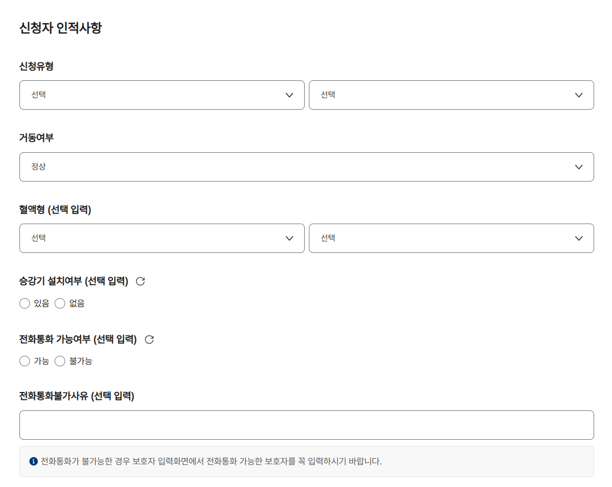
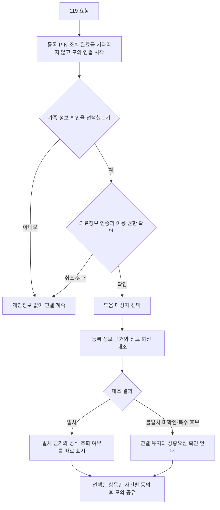

# 안심콜 등록·신고자·수혜자 연결 개선 검토

검토일: 2026-11-07. 아래 내용은 검토 작성 당시의 기획·소스 분석이다. **2026-11-08 일부 항목을 v0.18에 구현했으며, 최신 완료 범위는 [구현 보고서](SAFE_CALL_IMPLEMENTATION_V18.md)를 따른다.** 실제 기관 등록·조회 API는 미연결이다.

## 핵심 결론

차량에서 119를 요청하는 사람, 도움이 필요한 수혜자, 실제 신고 전화의 발신 회선은 서로 다를 수 있다. 이 셋을 분리해야 다른 가족의 병력이 표시되거나, 등록되지 않은 것으로 잘못 안내하는 문제를 줄일 수 있다. 번호 일치 확인과 의료정보 열람 권한 확인 역시 별개의 문제다.

예를 들어 자녀가 아버지를 대리 등록했더라도, 아버지가 아픈 상황에서 자녀 휴대전화로 신고하면 아버지 정보의 자동 표출을 보장할 수 없다. 경기도의 2026년 10월 안내는 대리 등록 후 수혜자 정보를 관리하는 절차와 함께, 대리인 전화로 신고하면 대리인 정보가 표출된다는 주의를 명시한다. 이는 개선 설계의 중요한 제약이다. [경기도 공식 안내 Q3·Q4](https://www.gg.go.kr/myggd/vol208/3_3.php)

따라서 **평소에는 가족별 정보·등록 상태를 정돈하고, 긴급할 때는 신고를 먼저 시작한 뒤 선택적으로 수혜자와 회선을 확인**하는 방향을 제안한다. 번호 불일치·미확인·조회 실패 때문에 신고를 막거나 통화를 자동 종료·재발신하지 않는다.

## 확인 근거와 한계

- 사용자가 제공한 가입 양식 이미지를 검토했다. 전체 가입 절차나 드롭다운 선택지, 필수값·기본값의 실제 동작은 확인하지 않았다.
- 사용자가 준 [네이버 블로그](https://blog.naver.com/safeppy/223763336291)는 본문 접근이 되지 않아, 내용을 읽은 것으로 간주하지 않았다. 아래 공식 공개 안내로 제도를 교차 확인했다.
- [소방청 안심콜 안내](https://www.nfa.go.kr/nfa/safetyinfo/emergencyservice/urelaxcallservice/)는 본인 및 대리인의 병력 등록과 신고 후 활용 절차를 설명한다.
- [정책브리핑 가입 소개](https://www.korea.kr/news/customizedNewsView.do?newsId=148940133)는 수혜자·대리자 가입 구분과 등록 정보의 활용을 설명한다.
- 차량 통화 경로는 [AOSP Bluetooth HFP 설명](https://source.android.com/docs/automotive/ivi_connectivity#hands-free-profile)을 참고했다. 연결된 휴대전화마다 통화 계정이 구분되며, 여러 기기 중 어느 계정으로 발신하는지 확인이 필요하다. 이것이 현재 Pleos 앱에 해당 통화 제어 권한이나 기능이 제공된다는 뜻은 아니다.
- 실제 119 상황실의 수동 식별·조회 절차, 차량 회선의 수혜자 매핑, 공개 등록·조회 API의 제공 여부와 이용 자격은 이번 조사에서 확정하지 못했다. **API가 존재한다고 가정하거나 번호만 전달하면 조회된다고 약속하지 않는다.**
- 현재 소스를 정적으로 분석했다. 공식 가입 실행, 실제 전화 발신, 기관 조회, 새 앱 화면의 사용성 시험은 수행하지 않았다.

사용자 제공 화면:

## 현재 구현과 부족한 부분

| 근거 | 현재 구현 | 개선할 부분 |
| --- | --- | --- |
| `data/PersonalHealthRecord.kt` | 본인의 이름·병력·알레르기·투약 내역을 기기에 암호화 저장. 가상 상황실에 자동 제공하지 않음 | 실제 가족별 수혜자 레코드, 등록 연락처, 등록자 역할, 출처·갱신일이 없음 |
| `core/Experience.kt`의 `PersonProfile` | 가상 가족별 `safeCallRegistered: Boolean`과 가상 보호자 키 | 본인/대리자·공식 등록 근거·수혜자 전화와 신고 회선을 표현하지 못함 |
| `core/Experience.kt`의 `safeCall()` | 가상 프로필의 Boolean에 따라 `MOCK_REGISTERED`/`MOCK_NOT_REGISTERED`를 반환 | 전화번호를 대조하지 않음. 프로필 미선택도 미등록 결과로 합쳐짐 |
| `ui/ExpansionUi.kt`의 `safePage()` | 등록된 가상 예시와 가상 연락 표식을 표시 | 연락 표식이 실제 수혜자 번호나 발신번호 검증을 뜻하지 않음 |
| `data/ExperienceData.kt`의 `DemoEmergencyCallGateway` | `MockDispatchGateway`를 사용하는 모의 요청 | 실제 발신 회선·SIM·통화 계정을 알지 못함 |
| `core/Experience.kt`의 `selectPerson()` | 수혜자 변경 시 의료 공유값·동의에 해당하는 상태·안심콜 결과 등을 초기화 | 이 원칙을 향후 등록번호 대조 결과와 비동기 조회 응답에도 확장해야 함 |
| `docs/MEDICAL_PRIVACY.md`와 기존 구현 | PIN/시스템 인증, 민감 화면 보호, 긴급 연결과 인증 분리 | 새 연락처·대리 권한·연계 결과에도 같은 보호 적용 필요 |

위 소스 경로는 `app/src/main/java/com/lifelink119/app/`를 기준으로 한다. 현재 개인 건강정보와 가상 가족 예시는 의도적으로 분리되어 있다. 이 구분을 제거하거나 직접 입력 정보를 동의 없이 신고 세션에 합치지 않는다.

### 우선 해결할 14개 항목

| 우선순위 | 문제 | 개선안 |
| --- | --- | --- |
| P0 | 수혜자·대리자 역할 없음 | ‘내 정보 관리’와 ‘가족 대신 관리’를 분리하고 대상 수혜자를 명시 |
| P0 | 신고자와 수혜자 혼동 가능 | 세션에 신고자 역할과 도움 대상자를 별도 관리. 운전자·디지털키·휴대전화 소유자를 환자로 자동 지정하지 않음 |
| P0 | 등록 여부가 Boolean 하나 | 미설정·본인 신고·가상 예시·공식 확인을 구분. 공식 확인 시 근거와 확인 시각 필요 |
| P0 | 프로필 미선택을 미등록으로 처리 | ‘대상 미선택’과 ‘조회 결과 없음’을 분리 |
| P0 | 등록 연락처와 실제 회선 대조 없음 | 가상 전화 식별자를 이용한 일치·불일치·확인 불가·복수 후보를 먼저 구현·시험 |
| P0 | 불일치 시 안내 경로 없음 | 연결 유지, 대상자가 신고자와 다름을 알리는 안내, 상황요원의 확인을 받는 경로 제공 |
| P0 | 병력·약력의 시점/출처 없음 | 직접 입력/예시/기관 조회 결과 구분, 마지막 확인일, 현재 복용과 과거 이력 구분 |
| P0 | 미입력을 ‘없음/정상’으로 오인할 수 있음 | ‘모름/미확인’을 별도 값으로 표현. 빈 항목을 정상·질환 없음으로 자동 변환하지 않음 |
| P0 | 대리 등록과 의료정보 열람 권한 혼동 | 보호자 연락처, 대리 등록 관계, 열람·수정 권한, 제공 동의를 별도로 모델링 |
| P0 | 조회 상태와 통신 오류가 단순함 | 미요청·지원 안 됨·처리 중·확인됨·미발견·실패·시간 초과를 구분. 오류를 미등록으로 표시하지 않음 |
| P1 | 번호 변경/듀얼 SIM/다중 휴대전화 | 실제 통화 계정 및 번호 확인 근거를 관리. 회선 변경·연결 해제 시 대조 결과 무효화 |
| P1 | 가족 간 공유 번호·휴대전화 없는 수혜자 | 전화번호를 수혜자의 고유 ID로 쓰지 않고 복수 후보를 명시. 공식 처리 규칙은 기관 협의 |
| P1 | 건강정보 고속도로 동의를 안심콜 등록으로 오인 | 의료정보 불러오기 동의, 안심콜 등록, 사건별 제공 동의를 분리. 자동 동기화 완료로 표시하지 않음 |
| P1 | 서버·로그·캡처로 신원 노출 우려 | 전체 연락처·이름·병력을 로그와 공개 캡처에서 제외. 인증·사건 범위·보존 기간을 포함한 운영 설계 |

P0는 **공모전용 모형에서 먼저 검증할 설계 우선순위**다. 이 표가 구현 완료 목록은 아니다.

## 가입 양식의 불편을 줄이는 방법

공식 양식을 차량 화면에 그대로 옮기기보다, 평소 입력과 긴급 조회를 나눈다. 평소 입력은 휴대전화/웹 중심의 후속 개발로 제안하며, 주행 중 차량 화면에서 긴 병력과 약력을 작성하게 하지 않는다. 현재 앱에 휴대전화 동반 앱이나 웹 가입 기능이 존재하는 것은 아니다.

| 제공 화면의 항목 | 개선 방향 |
| --- | --- |
| 신청유형의 선택란 2개 | 각 선택란의 의미가 드러나는 별도 라벨과 짧은 도움말. 실제 선택지는 확인 후 매핑하며 추정하지 않음 |
| 거동여부 | ‘혼자 이동 가능/도움 필요/확인 안 됨’ 같은 사용자 언어를 검토하되 공식 값과 매핑. 화면에서 ‘정상’이 보인다는 이유로 실제 기본값이라고 단정하지 않음 |
| 혈액형 선택란 2개 | 선택 입력과 ‘모름’을 유지. 미입력 때문에 등록 준비·긴급 연결이 막히지 않도록 설계하고 공식 필수값 규칙은 별도 확인 |
| 승강기 설치여부 | 주거지 구조 요청에 필요한 선택 정보로 분리. 차량 탑승 상황에서 반복 입력하지 않음 |
| 전화통화 가능여부 | 의사소통 지원 항목으로 정리. ‘불가능’ 선택 시에만 사유·보호자 안내를 펼침 |
| 전화통화 불가 사유 | 선택형과 짧은 추가 설명을 조합. 별도 대리자/보호자 입력으로 이동하기 쉽게 연결 |
| 병력·투약 내역 | 검색/선택과 자유 입력을 병행하는 후속 UI 검토. ‘없음’과 ‘모름’을 구분하고 확인일·출처를 표시 |

장문 양식 대신 `대상자 → 연락처·등록 상태 → 응급 참고정보 → 검토` 순서로 나누고 임시 저장·이전 단계 복귀를 제공하는 방향이다. 공식 사이트의 계정·비밀번호를 대신 보관하거나 화면을 자동 조작해 등록 완료를 추정하지 않는다.

차량에서는 인증 후 다음 내용만 짧게 요약한다: **도움 대상자, 등록 상태와 근거, 실제 통화 회선의 확인 상태, 현재 복용약·알레르기 등 선택한 응급 참고정보, 마지막 확인일**. 상세 병력·연락처 전체 보기는 별도 인증과 실제 CarUX 제한을 유지한다.

## 긴급 요청 흐름 개선안

실제 통화 연계는 향후 OEM/기관 협력 단계의 과제다. 현 단계에서는 위 흐름 전체를 가상 식별자와 모의 연결로만 구현한다.

### 대표 상황별 동작

| 상황 | 보여줄 판단 | 계속되는 행동 |
| --- | --- | --- |
| 수혜자 본인의 확인된 등록 전화와 회선이 일치 | ‘등록번호와 일치’. 공식 등록 확인 근거가 없다면 ‘공식 등록 미확인’도 함께 표시 | 연결 유지. 번호 일치만으로 병력 전체 자동 공개하지 않음 |
| 자녀 전화로 아버지에 대해 신고 | ‘신고자와 도움 대상자가 다름’, ‘등록번호와 다름’ | 통화 유지. 상황요원에게 다른 사람의 응급상황임을 알리는 안내 |
| 차량 자체 회선/eCall로 요청 | 수혜자 휴대전화와 동일한 번호라고 간주하지 않음 | 기본 신고 계속. 공식 조회 매핑은 별도 협력 과제 |
| 번호를 알 수 없거나 연결이 끊김 | ‘전화번호 확인 불가’ | 미등록으로 단정하지 않고 신고 계속 |
| 가족 여러 명이 같은 연락처를 사용 | ‘대상 확인 필요’ | 수혜자 선택/상황요원 확인. 한 명을 자동 선택하지 않음 |
| 수혜자가 잠금을 풀 수 없거나 대상 미상 | ‘개인정보 없이 진행’ | 긴급 요청을 유지하고 의료정보 인증을 우회하지 않음 |
| 조회 장애·시간 초과 | ‘등록정보 확인 실패’ | 신고 계속. 미등록으로 표시하지 않음 |
| 수혜자 또는 실제 회선 변경 | 이전 일치·조회·제공 동의를 무효화 | 새 대상과 회선을 기준으로 다시 확인 |

이미 통화가 진행 중이라면 등록된 번호에 맞추기 위해 전화를 자동으로 끊거나 다른 휴대전화로 재발신하지 않는다. ‘번호를 말하면 상황실에서 반드시 조회할 수 있다’는 안내도 하지 않는다. 별도 식별은 상황요원의 절차에 따르며, 해당 절차의 지원 범위는 기관 확인 대상이다.

## 데이터와 표시 원칙

전화번호 하나를 인증 수단·사람 ID·공식 등록 증거로 동시에 쓰지 않는다. 다음은 **후속 개발용 개념 필드**이며 기존 SDK/API의 필드가 아니다.

| 구분 | 제안 정보 |
| --- | --- |
| 수혜자 | 임의의 내부 ID, 정보 소유자, 연락처 참조, 의료정보 출처·확인일 |
| 등록자 | 본인/대리자 구분, 대상과의 관계, 관리 권한과 철회 상태 |
| 공식 등록 근거 | 가상 예시/사용자 진술/공식 확인 응답, 확인일, 검증 근거. 사용자 체크 하나로 공식 확인으로 승격하지 않음 |
| 신고 회선 | 휴대전화/차량 회선/알 수 없음, 통화 계정 참조, 번호 확인 근거, 연결 세대 |
| 대조 | 일치/다름/확인 불가/복수 후보와 그 근거. 마스킹한 번호 끝자리만으로 일치 판정하지 않음 |
| 조회 | 미요청/지원 안 됨/진행/확인/미발견/오류/시간 초과, 응답 출처, 대상·세션·요청 식별자 |
| 공유 | 선택 항목, 이번 사건의 동의, 철회/종료, 실제 수신 확인 여부 |

전화번호 자동 읽기는 해당 기기·회선·권한에서 검증해야 한다. Android도 `SubscriptionManager.getPhoneNumber()` 값이 통신사 등에 따라 없거나 부정확할 수 있어 민감한 용도에는 추가 검증이 필요하다고 설명한다. 이 API를 Pleos에서 즉시 호출 가능하거나 신원 확인 수단으로 사용할 수 있다고 가정하지 않는다. [Android 공식 API 설명](https://developer.android.com/reference/android/telephony/SubscriptionManager#getPhoneNumber(int))

인증 전에는 등록 전화번호·가족 이름·의료정보를 표시하지 않는다. 번호 전체를 소리 내어 읽거나 차량의 공개 화면에 노출하지 않는다. 현재 직접 입력 건강정보는 기존 정책대로 기기 내부에만 보관하며, 별도 설계·동의 없이 모의 상황실이나 향후 외부 연계에 포함하지 않는다.

## 공모전에서 검증할 범위와 실제 연계 과제

| 단계 | 할 일 | 완료 판단 |
| --- | --- | --- |
| 1. 공모전용 모형 | 수혜자/대리자 예시, 가상 등록 상태, 가상 신고 회선, 대조 결과, 오류/미선택 처리 | 아래 가상 시나리오를 통과하고 기존 개인정보 보호·긴급 연결 회귀 통과 |
| 2. 휴대전화/OEM 통화 경로 | 어느 기기·SIM·통화 계정이 실제 발신했는지 확인하고 회선 변경 이벤트 처리 | 실제 기기에서 허용된 일반 시험 환경의 통화 계정/번호 증거 확인. 실제 119 시험 발신은 별도 승인 없이 하지 않음 |
| 3. 소방청/소방본부 협의 | 등록·조회 연계 제공 여부, 인증·대리 권한·수혜자 식별·사건별 의료정보 제공·장애 대응 확인 | 승인된 인터페이스/시험 환경/접근 자격/수신 확인 계약이 확보된 범위만 구현·표시 |
| 4. 건강정보 고속도로 | 참여 자격과 항목별 동의·철회, 출처·갱신, 등록 정보와의 불일치 처리 | 의료정보 조회와 안심콜 등록이 서로 다른 절차임을 유지한 통합 시험 |

차량 SDK의 도어·SoC·에어백 값은 사고·차량 상태 보조정보다. 현재 사용 중인 SDK 조회 구현이 발신번호 검증이나 수혜자 인증을 제공하는 것은 아니다. 두 과제를 별도 어댑터와 근거로 다룬다.

## 후속 구현 인수 기준 — 아직 실행하지 않은 시험

실제 이름·연락처를 넣지 않고 `DEMO-PERSON-A`, `DEMO-PHONE-A/B`, `DEMO-VEHICLE-LINE` 같은 식별자만 사용한다.

| ID | 시험 | 기대 결과 |
| --- | --- | --- |
| SC-01 | 미등록·잠금 상태에서 119 요청 | 인증/정보 입력/조회 완료 없이 모의 연결 시작 |
| SC-02 | 대리자 예시가 수혜자 A를 관리 | 등록자와 수혜자 및 관리 범위가 구분됨 |
| SC-03 | 가상 등록 전화 A와 신고 회선 A 일치 | 가상 대조 일치 표시. 공식 기관 조회 성공으로 표시하지 않음 |
| SC-04 | 신고 전화 B, 수혜자 등록 전화 A | 불일치 안내와 통화 유지. B 소유자의 병력을 대신 표시하지 않음 |
| SC-05 | 차량 회선만 존재 | 수혜자 번호로 추정하지 않음. 기본 요청 계속 |
| SC-06 | 전화 식별 불가 | 미확인 표시. 미등록으로 단정하지 않음 |
| SC-07 | 수혜자 미선택 상태로 조회 선택 | 대상 미선택 안내. 미등록 조회 결과 생성하지 않음 |
| SC-08 | 같은 연락처에 복수 수혜자 | 복수 후보/추가 확인. 자동 의료정보 선택 없음 |
| SC-09 | A 확인 중 B로 대상 변경 | A의 늦은 응답 무시. 기존 공유값·동의·대조 결과 제거 |
| SC-10 | 회선 A에서 B로 변경/연결 해제 | 기존 일치 결과 무효화. 세대가 다른 응답 무시 |
| SC-11 | 오류·시간 초과·미발견·미지원 | 각각 구분. 모든 경우 기본 요청 계속 |
| SC-12 | PIN 취소·실패·만료·앱 전환 | 신원·의료정보 보호. 긴급 연결은 종료하지 않음 |
| SC-13 | 대리 권한/동의 철회 | 이후 열람·수정·공유 차단. 늦은 응답으로 복원되지 않음 |
| SC-14 | 건강정보 고속도로 동의만 완료 | 안심콜 공식 등록 상태 변화 없음 |
| SC-15 | 병력·약력 미입력/모름/없음 | 서로 다른 상태로 표시. 임의 정상 판정 없음 |
| SC-16 | 정보 변경 후 재확인 | 변경일·출처 표시. 과거 약력과 현재 복용을 구분 |
| SC-17 | 공유 항목 일부 선택 후 세션 종료 | 선택분만 모의 공유, 종료 시 사건 동의·전달 상태 정리 |
| SC-18 | 주행 중 상세 가입·병력 편집 | 실제 CarUX 제한 유지. 긴급 요청 가능 |
| SC-19 | 로그·저장 상태·공개 화면 검사 | 전체 번호·이름·병력·PIN 노출 없음, 민감 화면 캡처 보호 유지 |
| SC-20 | 외부 발신/기관 요청 검사 | 실제 전화·문자·기관 HTTP 요청 0건. 기존 콘솔의 민감 입력 차단 유지 |

현재는 소스·공개 제도·제공 화면을 분석한 단계다. 이 인수 기준을 통과했다고 주장하지 않으며, 새 기능을 구현할 때 단위 검사와 APK 빌드 및 실제 에뮬레이터 흐름 검증을 함께 수행해야 한다.
