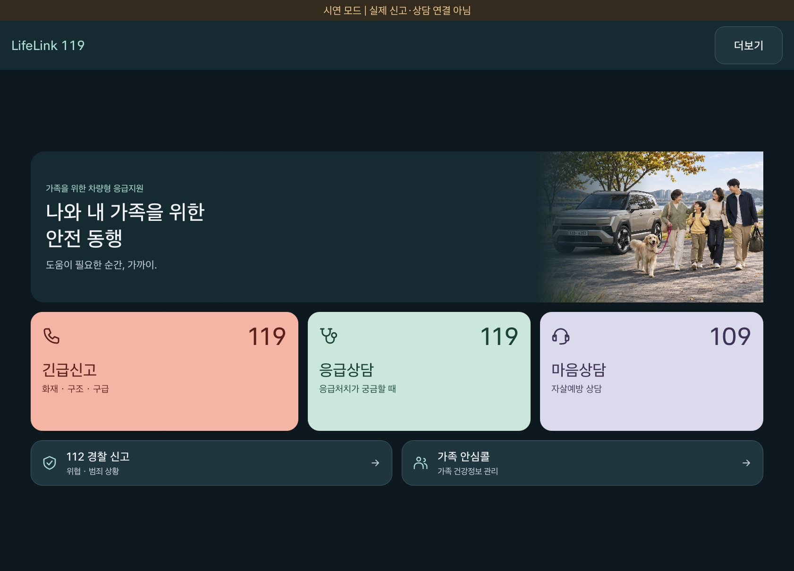
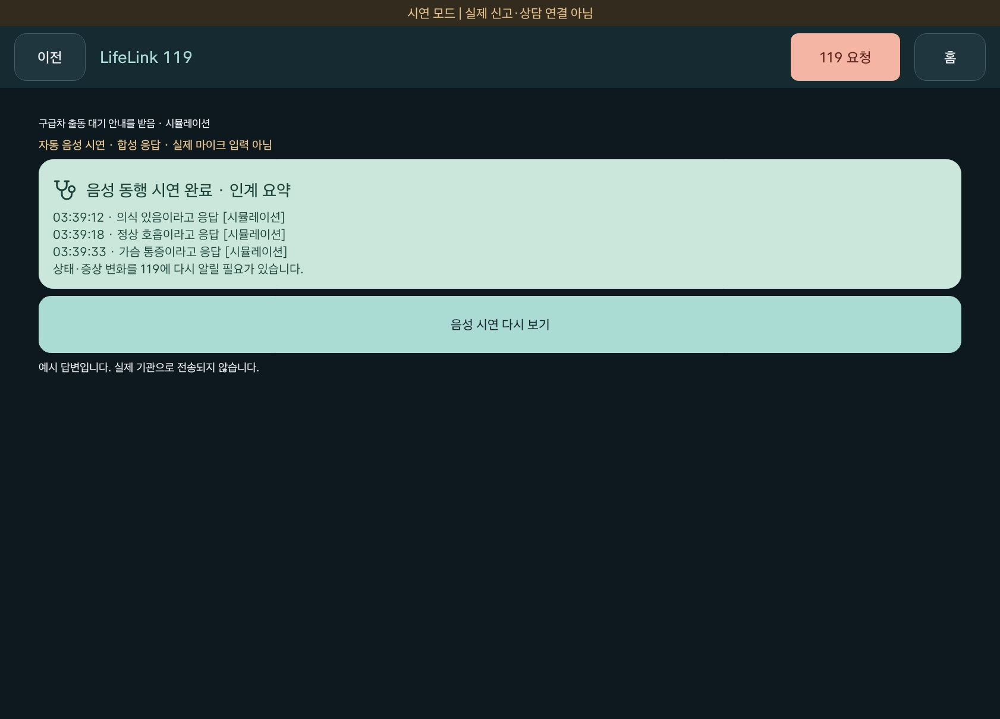

# 공모전 제출 release · 2026-11-15

[APK와 체크섬 다운로드](https://github.com/airwrap/LifeLink119/releases/tag/v0.18.1-contest-release) · [실행 방법](../README.md) · [기계 판독용 검증 기록](SUBMISSION_RELEASE_VERIFICATION.json)

## 제출물

| 항목 | 결과 |
|---|---|
| 파일 | `LifeLink119-v0.18.1-contest-release.apk` |
| 버전 / 패키지 | `0.18.1` (21) / `com.lifelink119.app` |
| 크기 | 151,935,970 bytes (약 152 MB) |
| 빌드 | `release`, `BuildConfig.DEBUG=false`, Android `debuggable=false` |
| 서명 | 전용 RSA 3072-bit 인증서, APK Signature Scheme v2 검증 성공; Android Debug 인증서 아님 |
| 인증서 SHA-256 | `ed27ca8fb4c914ea83b3dcf6701bb4b0e6c3fb3ba52131b19ea83a95d3a5ab7e` |
| APK SHA-256 | `d013570c1224616a987c5f174cd29874181e282c765470ee707cf22fd6bcc095` |
| 오프라인 자산 | Vosk 한국어 모델, 고정 안내·합성 응답 WAV 48개, 음성 구성요소 라이선스 고지 |

태그가 가리키는 커밋이 제출 소스 기준이다. Release 설명에도 최종 커밋 번호를 기록한다. 저장소 밖의 비공개 서명키와 `.env`는 배포하지 않는다.

## 이번 변경

- 가족·반려견 홈 이미지와 ‘나와 내 가족을 위한 안전 동행’ 문구를 포함했다.
- 기존 debug 인증서의 demo 빌드와 구분하여 **release 빌드 타입**에 제출용 서명·모의 기능 설정을 추가했다.
- `Build-Release.cmd`는 서명 설정이 없으면 중단하고, `-InitializeSigning`을 지정한 최초 실행에서만 저장소 밖에 키를 만든다. 키 폴더의 접근을 제한하고 비밀번호는 Windows DPAPI로 보호한다.
- `-PlifelinkSubmission=true`는 심사용 모의 기능과 기존 루프백 프록시를 활성화한다. 일반 release의 모의 네트워크 비활성화 정책은 유지한다. 네트워크 평문 예외는 `127.0.0.1`에만 적용한다.
- README를 제출물·실행·테스트 환경·화면 규격·빌드 절차 중심으로 정리하고 기존 내용은 `HISTORY.md`로 보존했다.

## 실행한 검증

| 검증 | 결과 |
|---|---|
| Spotless / debug·release 빌드 | PASS |
| debug 단위 테스트 | 288개 PASS |
| release 단위 테스트 | 288개 PASS |
| release lint | 오류 0; 테스트 라이브러리 새 버전 알림 경고 2개 |
| Python 콘솔 / 스크립트 | 98개 / 6개 PASS |
| 최적화 Python의 삭제 방지 가드 | 동일 6개 PASS (`python -O`) |
| 모의 데이터 계약 | PASS; 실제 위치·개인정보·동의 누락 자료 거부 |
| APK 서명·manifest 검사 | PASS; DEBUGGABLE·CALL_PHONE·SEND_SMS 권한 없음 |
| 새 공식 Pleos AVD 설치·실행 | PASS; 설치 APK와 배포 APK의 SHA-256 일치 |
| release UI / 오프라인 자동 음성 동행 | 아래 7개 흐름 PASS |

실행 환경: Pleos Connect **v2.1.0**, Android API 34 x86_64, Emulator **37.2.13**, **2560×1440 / 160 dpi**, RAM 4 GB. 전용 `LifeLink119_Release_QA_API_34` (`emulator-5586`)를 새로 만들었다. 기존 사용자의 앱 데이터는 지우지 않았다.

1. 최초 외부 AI 동의 화면에서 로컬 안내 선택 → 최신 가족·반려견 홈과 모의 시연 배너 확인.
2. 홈에서 119 긴급신고 → 모의 응급 세션 진입.
3. 119 응급상담 → 상담 화면과 종료 기능 확인.
4. 109 마음상담 → 상담 화면과 종료 기능 확인.
5. 더보기 → 자동 음성 동행 시작. 외부 AI와 마이크 입력 없이 합성 응답으로 진행.
6. 질문·응답 종료 → 의식·호흡·가슴 통증과 시각을 포함한 인계 요약 및 차량·출처 상세 확인.
7. 앱 재시작 → 로컬 안내 선택 유지, 최초 동의 화면 반복 없음.

네이티브 UI 검사는 제출 APK와 같은 인증서로 서명한 별도 로컬 검사 도구로 실제 View를 조작했다. 이 도구는 APK/Release에 포함하지 않는다. 검사 후 일반 Activity 실행 명령으로도 정상 기동을 확인했다. PC 프록시로의 ADB 터널 없이 실행했고 외부 LLM은 사용하지 않았다. 이 검증은 사람 음성의 인식률이나 실차 오디오 품질 시험이 아니다.

## 남은 범위

실제 긴급전화·기관 접수·출동, 소방청 안심콜 자동 조회, 차량 실내 온도·CO₂·CO·잔류 탑승자 센서 연동은 제출 APK의 제공 기능이 아니다. 사용자 입력 기반 로컬 건강정보와 모의 상황을 구분한다. 의료전문가 콘텐츠 검토, 사람의 억양·차량 소음·실차 SDK 검증은 후속 과제다.

최신 시연영상은 같은 가족·반려견 UI가 적용된 직전 개발 빌드에서 촬영했다. 제출 패키징 변경 후 위 release 실행 검증을 별도로 수행했다.
