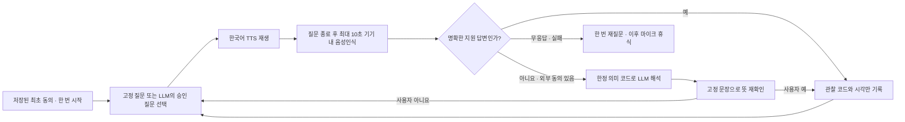

# 음성 중심 AI 응급 대기 동행

2026-11-15 · LifeLink 119 v0.18.0-demo

같은 날 진행한 선택지 축소, 안심콜 정보 재사용, 위험 안내·음성 인식 보강 및 개정 PPTX/PDF는 [음성 중심 UX 개선 기록](UX_REFINEMENT_20261115.md)에 정리했다.

## 사용 순서

1. **최초 앱 실행**에서 **동의하고 시작**을 한 번 선택한다. 외부 AI에는 질문 단계·필요한 증상 의미 코드만 보낸다. 선택은 이 차량의 앱에 저장되며 앱 재실행·화면 이동·새 사건마다 다시 묻지 않는다. 거절도 저장한다. Android 마이크 권한은 OS가 최초 한 번 별도로 요청한다.
2. **119 연결 화면 → AI 음성 동행 시작**을 한 번 누른다. 이전의 중간 동행 시작 화면과 외부 AI 체크박스를 거치지 않는다. 통화 중이 아닐 때 사용한다.
3. AI 질문이 끝나면 “예”, “아니요”, “잘 모르겠어요”로 답한다. 다음 질문과 필요한 고정 안내가 자동으로 이어진다. 명확하지 않은 모델 해석은 짧은 확인 질문을 거친다.
4. “그만” 또는 **음성 잠시 멈춤**으로 중단한다. **화면으로 답하기**는 음성을 멈추고 큰 응답 버튼을 펼친다.
5. **더보기 → 음성 AI 설정**에서 외부 AI 사용을 언제든 변경한다. 외부 AI를 꺼도 기본 음성 안내는 계속 사용할 수 있다. 동의 철회는 진행 중 요청을 취소하고 이후 외부 요청을 막는다.

실제 전화 발신·기관 접수·출동 상태 수신은 여전히 모의 기능이다. 시작 동작은 음성 사용 요청이며 접수·콜백·출동 상태를 확정하지 않는다. 이미 상담원 연결로 확인된 상태와 통화 오디오 모드에서는 음성을 시작하지 않는다.

## 한 번 시작하는 자동 시연

**더보기 → 음성 동행 자동 시연**을 누르면 마이크가 있는 사용 흐름을 예시 음성으로 재현한다. 추가 답변 버튼이나 마이크 장치 확인 절차 없이 약 1분간 진행한다.

| AI 질문 | 예시 음성 응답 |
|---|---|
| 환자는 의식이 있나요? | 네 |
| 정상적으로 숨을 쉬나요? | 네 |
| 불·연기·차량 갇힘이 있나요? | 아니요 |
| 피가 많이 나나요? | 아니요 |
| 가슴에 통증이 있나요? | 네 |
| 아까보다 상태가 나빠졌나요? | 아니요 |

흉통 답변 후에는 기존 고정 응급 안내를 읽는다. 끝나면 **인계 요약을 자동 표시**하며 **음성 시연 다시 보기**로 반복할 수 있다. 모든 답변과 출동 대기 상태는 화면과 데이터에 시뮬레이션으로 표시한다. 예시 음성 재생은 실제 마이크 인식 결과가 아니며, 외부 AI 사용은 저장된 동의에 따른다. 이 모드는 `DemoEmergencySpeech`가 답변만 제공하고 실제 대화 상태 관리·고정 안내·요약 로직은 공통으로 사용한다.

## 구현 범위



- TTS와 마이크를 동시에 열지 않는다. Android 한국어 로컬 TTS를 우선 사용하며, 없으면 Windows 한국어 TTS로 미리 생성한 고정 안내 음원을 APK에서 재생한다.
- Android 기기 내 STT를 우선 사용한다. 해당 서비스가 없는 Pleos 에뮬레이터에서는 Vosk 한국어 소형 모델로 기기 안에서 인식한다. 클라우드 STT로 자동 전환하지 않는다.
- 예/아니요 질문과 재확인은 제한 어휘와 한국어 모델의 `<UNK>`를 사용한다. 낮은 신뢰도, 미확인 발화, 무응답은 환자의 답변으로 저장하지 않는다. 주변 소리를 무조건 예/아니요에 대응시키지 않는다.
- 외부 LLM은 승인된 질문 ID와 관찰 코드만 반환한다. 원문, 녹음, 이름, 전화번호, 위치, 가족정보는 보내지 않는다. `BREATH`, `DIFFICULT` 같은 의미 코드도 건강 맥락을 포함하므로 별도 동의를 받는다.
- AI 해석으로 정상 상태·질환·신고 완료를 확정하지 않는다. 위험 진술은 기존 규칙과 고정 안내를 우선하며 외부 응답을 기다리지 않는다.
- 무응답은 한 번 재질문하고 마이크를 쉰다. 계속 녹음하거나 무기한 대기하지 않는다. “변화 없어요”도 회복·정상 호흡으로 추론하지 않는다.
- 통화 연결 확인, 재연결 시도, 화면 이탈, 앱 백그라운드, 오디오 포커스 상실 및 통화 오디오 모드에서 중단한다. 늦게 도착한 모델·음성 결과는 폐기한다.

## 파일

| 파일 | 역할 |
|---|---|
| `core/emergency/VoiceAiConsent.kt`, `data/VoiceAiPreferences.kt` | 최초 동의·거절·철회를 앱 재실행 후에도 유지 |
| `ui/VoiceAiSetupUi.kt` | 최초 실행 안내와 더보기의 변경 화면 |
| `core/emergency/DemoEmergencySpeech.kt` | 마이크 없이 재현하는 합성 응답 시연, 중단·완료 표시 |
| `core/emergency/EmergencyVoiceConversation.kt` | 발화 규칙, 한정 의미 코드, 질문·듣기·확인·중단 상태 관리 |
| `data/EmergencyVoice.kt` | 오디오 포커스, 한국어 TTS/고정 음원, Android 기기 내 STT |
| `data/OfflineKoreanSpeech.kt` | Vosk 모델 준비, 제한 어휘, 신뢰도 검사, 메모리 내 인식 |
| `data/EmergencyNetwork.kt` | 키가 없는 앱의 로컬 프록시 호출 |
| `ui/EmergencySupportUi.kt` | 음성 우선 시작 화면, 질문/듣기 표시, 접힌 수동 응답 |
| `console/llm_config.py` | 안전한 dotenv 읽기, 서버 환경변수 우선순위, `/v1` 주소 보정 |
| `console/emergency.py` | 승인 질문 선택·의미 코드 해석, 제한·타임아웃·출력 검사 |
| `scripts/prepare-offline-speech.py` | 체크섬을 고정한 한국어 모델과 고정 음원 준비 |
| `scripts/start-voice-demo.ps1` | 마이크 장치 유무에 맞춘 QA 에뮬레이터 음성 실행 |

## 실행과 재현

개발 셸에서 프로젝트 폴더 `LifeLink119`를 기준으로 실행한다.

```powershell
# 현재 패키지는 이미 준비되어 있다. 새 환경에서 오프라인 모델/음원 재구성:
python scripts/prepare-offline-speech.py

# 기존 서버는 소유 확인 후 정상 종료. 새 서버가 상위 .env를 읽는다.
.\Stop-Local-Demo.cmd
.\Start-Local-Demo.cmd

# 현재 사용하는 QA AVD만 재시작. 앱 데이터는 삭제하지 않는다.
powershell -ExecutionPolicy Bypass -File scripts/start-voice-demo.ps1 -Restart
adb -s emulator-5584 reverse tcp:8781 tcp:8781
adb -s emulator-5584 install -r app/build/outputs/apk/debug/app-debug.apk
```

자동 시연은 마이크 유무와 관계없이 고정 질문과 합성 응답을 재생한다. 실제 사용에서는 기기 마이크로 답한다. 음성 런처는 사용 가능한 마이크를 자동 연결하고, 없는 경우 입력 장치만 꺼 DirectSoundCapture 반복 오류를 방지한다. 일반 시연 런처의 `-no-audio` 설정은 유지하므로 음성 시연에는 새 런처를 사용한다.

더블클릭 실행은 패키지의 `.tools/Start-LifeLink-Voice-Demo.cmd`를 사용한다. 같은 QA AVD를 재시작하고 서버·ADB 터널·현재 APK 실행을 준비한다.

한국어 모델은 `.tools/speech/assets/speech`에 준비하고 APK에 포함한다. 모델과 고정 음원이 없는 소스 복사본도 컴파일되지만 기본 STT/TTS가 없는 기기에서는 음성 기능이 제한된다. 모델 크기 약 83 MiB(압축), 런타임 메모리 증가가 있으므로 실차 성능 검증이 필요하다.

## 검증 및 한계

최초 동의·바로 시작·자동 시연의 최신 검증은 [최소 조작 검증 기록](MINIMAL_VOICE_VERIFICATION.json)을 따른다. Android 영구 저장 검사, 합성 음성 전체 대화의 core 검사, UI에서 재실행·철회·자동 인계 요약·통화 중단을 추가했다.

외부 LLM의 실제 연결을 시험용 질문/의미 코드로 확인했다. 키, 주소, 발화 원문을 검증 로그에 기록하지 않았다. 네트워크·음성 상태 전이 및 결과 폐기 단위 테스트와 실제 Android 재생→듣기→무응답 휴식 UI 검사를 추가했다. [검증 결과 JSON](VOICE_AI_VERIFICATION.json)에 동일 APK의 SHA-256과 검사 내역을 보관했다.

| 최종 검사 | 결과 |
|---|---|
| `Build-And-Test.cmd` | debug/demo/release, 단위 검사, 포매터, debug/demo lint 성공 |
| Kotlin / Python | 272개 / 95개 통과 |
| 실제 LLM을 사용하는 음성 UI / 기존 응급 흐름 UI (회귀) | 6개 / 12개 통과 |
| Android Vosk 합성 음성 7종 | 예·아니요·호흡 없음·중단 인식 4종, 불명확한 긴 발화 2종과 무관한 발화 1종 거부 |
| 비밀정보 검사 | 3종 APK에 .env·설정 키·서버 주소 없음, 검사한 로그에도 없음 |
| 음성 런처 전체 재시작 | 설치·서버·ADB·앱 실행 성공, DirectSoundCapture 반복 오류 없음 |

lint 오류는 0건이다. AndroidX 테스트 라이브러리의 새 버전 알림 2건은 남아 있다.

합성 음성 검사는 예/아니요·중단 명령의 인식과 긴 발화를 확실하지 않은 경우 거부하는 동작을 검증한다. 자유로운 긴 문장을 모두 정확히 알아듣는다는 의미가 아니다. 사람의 억양, 차량 소음, 마이크 품질, 실제 통화/블루링크 전환은 별도 실차 시험이 필요하다. 주행 중 상세 입력을 여전히 제한하며 응급 안내는 의료전문가 검토 전 시연 콘텐츠다. release 빌드는 외부 프록시용 INTERNET 권한이 없고, 현재 외부 모델은 debug/demo의 ADB 루프백을 통해서만 연결한다.

## 근거와 구성요소

- [Android SpeechRecognizer](https://developer.android.com/reference/android/speech/SpeechRecognizer), [TTS 완료 콜백](https://developer.android.com/reference/android/speech/tts/UtteranceProgressListener): 재생 완료 후 듣기 전환, 기기 내 STT 선택.
- [Vosk 한국어 소형 모델](https://alphacephei.com/vosk/models): `vosk-model-small-ko-0.22`, Apache 2.0. 다운로드 파일 SHA-256 `eea36124087fed26c59996a4761519458e3bd185e8ea9d9865ad8760c4a1d989`.
- [공식 Android 예제](https://github.com/alphacep/vosk-android-demo): `vosk-android:0.3.75`, `jna:5.18.1` 사용. 생성된 고정 음원은 Microsoft Heami 로컬 TTS 출력이며 사람의 목소리 녹음이 아니다.
- [외부 LLM 설정과 데이터 경계](LLM_PROXY_SETUP.md).
